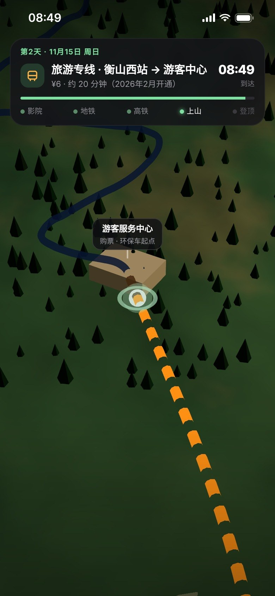

# From Button to Bottom

**door-to-seat trip preview · 出发前，先把每一段坐一遍**

From Button to Bottom 指的是从按下按钮，一直到坐下。这是一段 3D 概念演示：你按下“开始预演”，它把一整趟行程从地图路线一路串到每一段的座位视角。坐在哪、看到什么、几点到、留了多少缓冲，出发前就能全部看一遍。



▶ 演示视频：`media/from-button-to-bottom.mp4`（9:16，约 87 秒，全部实时 3D 渲染，无实拍素材）

## 为什么做这个

市面上已经有影院选座的 3D 视角，也有高铁选座、球场选座、地图路线动画，但每一个都只管一段。爱做攻略的人真正想看的是**整趟**：酒店走到影院要多久，哪一排看得最舒服；第二天地铁到高铁站留多少缓冲，哪个窗位不被窗间墙挡；下车后怎么上山，几点能登顶。

这个项目把这些单点串成一条线。

## 演示行程（长沙 → 南岳衡山，2 天）

| 段落 | 内容 | 决策点 |
|---|---|---|
| 第 1 天晚 | 长沙IFS国金中心·异国印象酒店 → 步行 → 万达影城 IMAX | 选座：G排09座，最佳观影区正中，看银幕视角 |
| 第 2 天早 | 地铁2号线 湘江中路 → 长沙南（约 23 分钟）→ G6021 07:52 → 衡山西 08:20 | 选座：6车06F，确认正对整扇车窗 |
| 第 2 天上午 | 旅游专线 ¥6 → 游客服务中心 → 环保车至南天门（约 1100 m）→ 步行约 1 小时至祝融峰（1300.2 m） | 路线与海拔随进度实时显示，登顶看云海 |

顶部常驻行程卡显示当前时间、进度和这一段的缓冲时间，结尾是全程总览。

> ⚠️ 演示用途：地图、城市、山体都是程序生成的示意，不是测绘数据。座位、余票是虚构的。车次、票价、景区价格来自 2026 年 11 月公开网页，各来源互有出入（例如 G6021 二等座有 ¥71 和 ¥75 两种写法），请以 12306 和景区当日公告为准。索道运营状态未确认，所以没有放进演示。

## 运行

```bash
# 在仓库根目录
python3 -m http.server 8766
# 浏览器打开 http://localhost:8766/index.html，在控制台执行 renderFrame(t)，t 为秒
```

逐帧渲染成视频（需要 Chromium 与 Python Playwright）：

```bash
PORT=8766 python3 tools/render.py . 0 2610     # 30fps，共 87 秒
ffmpeg -framerate 30 -i frames/f%04d.jpg -c:v libx264 -crf 18 -pix_fmt yuv420p out.mp4
```

## 结构

- `src/main.js`：时间轴、界面状态、镜头
- `src/city.js`：长沙夜景与清晨的城市、步行和地铁路线
- `src/cinema.js`：IMAX 影厅与选座视角
- `src/train.js`：高铁车厢，车窗按行程位置排布，车外景物滚动
- `src/region.js`：长沙南 → 衡山西 区域图
- `src/mountain.js`：衡山山体、盘山公路、登山步道、云海
- `src/util.js`：路线绘制、标记、噪声等工具

## 致谢

- **[@RaminNasibov](https://x.com/RaminNasibov)**：他的影院选座视角 App 设计视频是这个想法的起点。<https://x.com/RaminNasibov/status/2119378104892211287>
- **[@Jackywine](https://x.com/Jackywine)**：他的 12306 分步引导演示，是推动这个项目往前走的催化剂。<https://x.com/Jackywine/status/2120376448280400338>

### 背景音乐

`media/from-button-to-bottom.mp4` 的背景音乐由 Google Flow Music（Lyria 3.5）生成，曲名 “Product Demo (Cinematic Electronic)”，已剪辑至 87 秒。音乐的使用受 Flow Music 服务条款约束，不在本仓库的许可证范围内。

### 相关项目与灵感

本仓库代码为独立编写，未复制以下项目的代码。列出它们，是因为它们证明了单个场景可行，也给了思路：

- [codrops/CinemaSeatPreview](https://github.com/codrops/CinemaSeatPreview)：影院座位视角预览（MIT）
- [xisanpi/zuonaar-cinema-simulator](https://github.com/xisanpi/zuonaar-cinema-simulator)：国内 IMAX / 杜比影厅视角模拟（MIT）
- [thebuggeddev/football-stadium](https://github.com/thebuggeddev/football-stadium)：球场选座视角（PolyForm Noncommercial）
- [virakri/shinkansen-3d-seat-booking-prototype](https://github.com/virakri/shinkansen-3d-seat-booking-prototype)：新干线 3D 选座原型（MIT）
- [SpaceZephyr/map-motion](https://github.com/SpaceZephyr/map-motion)：地图路线动效
- [wang-bool/Travel-Story](https://github.com/wang-bool/Travel-Story)：行程转地图视频（MIT）
- [three.js](https://github.com/mrdoob/three.js)：渲染引擎，`three.module.js` 与 `RoundedBoxGeometry.js` 按其 MIT 许可证随仓库分发

## 许可证

源码公开，但**不是** OSI 定义的开源许可证。

- 个人、学习、研究、非营利用途：按 [PolyForm Noncommercial 1.0.0](LICENSE.md) 免费使用。
- 企业或任何商业用途（包括产品集成、商业演示、付费服务）：需要单独的商业授权，请联系 limiaohua25@gmail.com。

Required Notice: Copyright (c) 2026 Miaohua Li (https://github.com/LMH-gh/from-button-to-bottom)

three.js 相关文件版权归 three.js authors 所有，适用 MIT 许可证，见 `THIRD_PARTY_NOTICES.md`。
